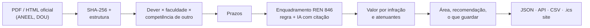

<div align="center">
  
</div>

# Athenix

**O Athenix automatiza o fluxo regulatório: da publicação da norma no Diário Oficial ao plano de
ação dividido por área, com prazo, valor em risco e o que guardar como prova.**

- **Demo executiva:** <https://athenix-two.vercel.app/demo/executivo>
- **Plano completo:** <https://athenix-two.vercel.app/demo> (RN ANEEL 1.137/2025) e
  <https://athenix-two.vercel.app/demo?norma=ren1174> (REN ANEEL 1.174/2026)

Começa pelo setor elétrico (normas da ANEEL, perfil de distribuidora). É um MVP técnico: funciona
de ponta a ponta em duas normas reais, ainda sem validação comercial nem revisão jurídica humana.

## Como rodar em 3 comandos

Precisa de Python 3.11 ou mais recente e Git. Sem chave de API, sem conta, sem variável de ambiente.

```bash
git clone https://github.com/emilynespoli-lab/Athenix.git && cd Athenix
python -m venv .venv && . .venv/bin/activate        # Windows: .venv\Scripts\activate

python -m pip install -r requirements-dev.lock       # 1. instalar  (~30 s)
python -m pytest -q                                  # 2. testar    (~2 min)
python -m athenix processar tests/norma_poc/ren20251137.pdf --saida plano.json   # 3. processar (~16 s)
```

Saída do passo 3 (conferida num clone e venv novos em 21/11/2026):

```text
Athenix · processar ren20251137.pdf para distribuidora
  Norma: RN ANEEL 1.137/2025 (sem chamada de IA nem rede; sugestões de IA só do cache versionado, marcadas)
  1. Obrigações extraídas: 168 dispositivos lidos
  2. Deveres da distribuidora: 153 · outros dispositivos (faculdades, direitos, outros agentes): 14 · fora do perfil: 1
  3. Prazos: 7 vencidas · 0 nos próximos 90 dias · 2 recorrentes · 144 sem data
  4. Enquadramento na REN 846: 43 identificados no texto · 110 a confirmar (102 com sugestão da IA em cache, marcadas) · 0 sem multa
  5. Temas: 8 · plano gravado em plano.json
```

No clone limpo o passo 2 dá `496 passed, 6 skipped`: os 6 dependem de dados locais que não vão para
o Git (CSV de autos, votos da ANEEL). A segunda norma:
`python -m athenix processar tests/fontes_impacto/dou/dou_ren20261174.html --saida plano.json`.

## Como funciona



Regras determinísticas fazem a extração, os prazos e o cálculo; a IA só sugere onde a regra não
alcança, sempre com citação literal conferida na fonte e marcada como "aguarda revisão humana".
Cada etapa, com o módulo, os testes e um exemplo real: [docs/ARQUITETURA.md](docs/ARQUITETURA.md).
O que existe e o que funciona, com a saída dos comandos: [docs/INVENTARIO_TECNICO.md](docs/INVENTARIO_TECNICO.md).

## Qualidade (números conferidos em 21/11/2026, commit `887cd2f`)

| | Número | De onde vem |
| :-- | :-- | :-- |
| Testes automatizados | **502 em Python + 112 no site** | `python -m pytest -q`; `npm test` no CI |
| CI | **verde em Ubuntu, Windows e macOS** | `.github/workflows/ci.yml`, execução 44917313898 |
| Trava do gabarito | **20 de 20 casos**, citações corretas 0,9954, sem regressão | `python scripts/avaliar.py --rotulo local --comparar tests/baseline/metricas_v1.json` |
| Citações conferidas contra o arquivo oficial, com outro extrator | **535 de 535** (RN 1.137: 228; REN 1.174: 307) | `python scripts/demo/conferir_citacoes.py` |
| Segunda leitura independente da REN 846 (outro modelo) | **108 de 108 infrações no mesmo grupo** (catálogo: 109) | `python scripts/demo/conferir_segunda_leitura.py` |
| Auditorias independentes (21/11) | amostra de **20 de 20 citações** conferidas; achados da primeira auditoria corrigidos no #43 (`tests/test_auditoria.py`); achados abertos da segunda em [Limitações](#limitações-e-roteiro) | relatórios locais das auditorias |
| Tempo da norma ao plano | **16,1 s** (RN 1.137, 31 páginas) · **12,1 s** (REN 1.174), mediana de 3 | `python scripts/demo/medir_normas.py` → [docs/pitch/metricas.md](docs/pitch/metricas.md) |
| Custo de IA | **US$ 1,02 para as duas normas (≈ US$ 0,51 por norma)**; reprocessar custa US$ 0 (cache) | `python scripts/demo/custo_ia.py` |

O export do plano é reproduzível: o CI regenera os dois JSONs do site e compara com os versionados
(`python scripts/exportar_plano_demo.py --verificar`).

## Integrações

- **API HTTP (FastAPI):** envia o arquivo da norma e recebe as obrigações com citação verificada,
  hash e trilha de auditoria. Rotas, `curl` e PowerShell em [docs/API.md](docs/API.md). Demonstração
  em um comando: `python scripts/demo/demo_api.py`.
- **Comando único:** `python -m athenix processar <arquivo> --agente distribuidora --saida <json>`,
  do arquivo oficial ao JSON do plano.
- **CSV por área:** no site, "Quem faz o quê" baixa as tarefas por área responsável; na API,
  `GET /export/csv`.
- **Calendário (.ics):** os prazos do plano vão para Outlook ou Google Agenda pelo site.
- **Aplicativo web local:** `python -m athenix demo` sobe o app com login (usuário `demo`, senha
  gerada na hora), a RN 1.137 já processada, ficha de cada obrigação com o trecho destacado,
  revisão humana e exportação.
- **Banco:** SQLite local (padrão) ou PostgreSQL com `docker compose up -d --build`
  (detalhes em [docs/API.md](docs/API.md#subir) e
  [docs/INVENTARIO_TECNICO.md](docs/INVENTARIO_TECNICO.md#banco)).

### Modos de IA

A IA é opcional. O modo vem de `ATHENIX_AI_MODE` e aparece em `/health` e na saída da CLI.

| Modo | O que faz |
| :-- | :-- |
| `off` (padrão) | Nenhuma chamada de rede. Regras + sugestões já gravadas no cache versionado. |
| `cached` | Só reaproveita respostas gravadas no banco; nunca faz chamada nova. |
| `live` | Chama o provedor só com modelo, chave, preço com fonte e data e teto de custo (`ATHENIX_RUN_BUDGET_USD`); senão cai para `off` e diz o motivo. |

## Fontes de dados

Só fontes oficiais e públicas, versionadas com SHA-256 em `tests/fontes_impacto/fontes.json`:
PDFs da ANEEL (`www2.aneel.gov.br/cedoc`), HTML e página certificada do Diário Oficial da União
(`in.gov.br`), leis do Planalto e o dicionário dos dados abertos da ANEEL. Nada com termos de uso
restritivos vai para o repositório (o `.gitignore` bloqueia cópias de terceiros e a pasta `.local/`).
Os CSVs dos dados abertos de autos de infração ficam fora do Git e alimentam só a referência de escala.

## Limitações e roteiro

**Limitações conhecidas** (detalhes em [docs/ARQUITETURA.md](docs/ARQUITETURA.md#limitações-conhecidas)):
- Nenhum enquadramento revisado por especialista; na REN 1.174 todos são sugestão da IA.
- Prazos provisórios, contados da publicação ou da vigência.
- Achados abertos da auditoria de 21/11/2026: o singular "pode" ainda vira dever num caso (item
  145(a) da RN 1.137); prazos em minutos e horas não são lidos (item 105); o relatório-piloto não
  roda no CI.
- Duas normas no plano; 49 deveres ainda com área "A definir"; PostgreSQL não testado nesta conferência.

**Roteiro:**
1. Monitoramento automático do DOU (desenho em [docs/INLABS.md](docs/INLABS.md)).
2. Compilação de normas por data (base em [docs/COMPILACAO.md](docs/COMPILACAO.md)).
3. "O que mudou para mim": a diferença entre versões, filtrada pelo perfil da empresa.
4. Base que liga multas aplicadas às obrigações que as originaram.
5. API para clientes que devolve o plano completo (hoje a API devolve as obrigações; o plano sai do
   comando único).

## Licença e responsabilidade

Código sob a **PolyForm Noncommercial License 1.0.0** ([LICENSE](LICENSE)): uso, cópia e modificação
para fins não comerciais; uso comercial depende de autorização do titular. Copyright (c) 2026 Athenix.

> Os resultados são auxiliares e devem ser revisados por profissionais habilitados. O Athenix não
> oferece parecer jurídico nem garante conformidade regulatória. Valores calculados sobre um perfil
> ilustrativo, que não corresponde a nenhuma empresa real.

Produto e posicionamento: [docs/POSICIONAMENTO.md](docs/POSICIONAMENTO.md).


