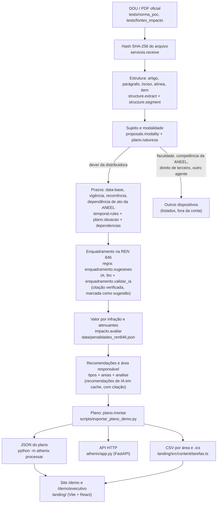

# Arquitetura do Athenix

O Athenix automatiza o fluxo regulatório: da publicação da norma no Diário Oficial ao plano de ação
dividido por área, com prazo, valor em risco e o que guardar como prova. Este documento mostra
**como**: cada etapa, o módulo que a faz, como ela é testada e um exemplo real.

Números e exemplos conferidos em 21/11/2026 no commit `887cd2f` (`main`). Exemplos tirados de
`landing/src/content/plano-rn1137.json`, o plano publicado da RN ANEEL 1.137/2025.

## Fluxo

O comando único (`python -m athenix processar`) passa pela própria API: `exportar_plano_demo.processar`
sobe o app FastAPI num banco SQLite descartável, envia o arquivo e lê as obrigações por
`/api/obligations`. O plano do site e o que um cliente receberia por HTTP saem do mesmo caminho.

## Etapas

### 1. Arquivo oficial → SHA-256
- **O que faz:** recebe o PDF ou o HTML oficial, detecta o tipo pelo conteúdo (não pela extensão),
  calcula o SHA-256 e guarda os bytes imutáveis. Se o mesmo arquivo chegar duas vezes, ele é
  reaproveitado (deduplicação por hash).
- **Módulo:** `athenix/services.py` (`receive`), `athenix/structure.py` (`detect_media`).
- **Testes:** `tests/test_workflow.py`, `tests/test_migrations_pdf.py`, `tests/test_source_check.py`.
- **Exemplo:** `tests/norma_poc/ren20251137.pdf` →
  `sha256 4a581592e981158bb9a9ebbbed10a019d3c06399fd2890389bf88f3609cc5887`, gravado no JSON do plano
  (`norma.sha256`) e conferido de novo por `scripts/demo/conferir_citacoes.py`.

### 2. Estrutura (artigo, parágrafo, inciso, alínea, item)
- **O que faz:** extrai o texto (pdfplumber; HTML convertido em texto, nunca executado), trata
  colunas, texto riscado e o ruído do DOU, e segmenta em unidades com posição exata no texto canônico.
- **Módulo:** `athenix/structure.py` (`extract`, `segment`, `page_sides`, `mark_struck`),
  `athenix/normalizacao.py` (normalização só para comparar; o texto guardado não muda),
  `athenix/dou.py` (leitura do HTML e da página certificada do DOU, usada na comparação HTML × PDF).
- **Testes:** `tests/test_structure_temporal.py`, `tests/test_dou.py`, `tests/test_normalizacao.py`,
  o gabarito (`tests/gabarito/`, trava `scripts/avaliar.py`).
- **Exemplo:** RN 1.137 → 31 páginas, 315 unidades estruturais; REN 1.174 (HTML do DOU) → 368
  unidades (`scripts/demo/medir_normas.py`).

### 3. Sujeito e modalidade (dever × faculdade × competência de outro)
- **O que faz:** decide se o dispositivo é **dever da distribuidora**, **faculdade** ("pode", não
  "deve"), **competência da ANEEL**, **direito de terceiro**, **dever de outro agente** ou **regra de
  transição**. Inciso sem sujeito próprio herda o sujeito do caput; o emissor do caput também conta.
  Dever de sujeito impessoal em norma dirigida às distribuidoras é marcado "sujeito implícito".
- **Módulo:** `athenix/proposals.py` (`modality`, gerador por regras), `athenix/plano.py`
  (`natureza`, `caput_do_dispositivo`, `sem_dever_identificado`).
- **Testes:** `tests/test_prazos_e_sujeito.py`, `tests/test_proposals_ai.py`, `tests/test_auditoria.py`.
- **Exemplo:**
  - item 106: «Alternativamente, podem oferecer uma visualização interativa da rede elétrica…» →
    `faculdade` (listada em "Outros dispositivos", fora da conta).
  - Art. 10, I: «articular, coordenar, monitorar… as providências… a serem adotadas pela ANEEL…» →
    `competencia_aneel`.
  - Resultado RN 1.137: 168 dispositivos classificados → 153 deveres, 14 outros, 1 fora do perfil.

### 4. Prazos (data-base, vigência, recorrência, dependência de ato da ANEEL)
- **O que faz:** encontra o prazo no texto ("até 90 dias", "anual", "na data de publicação"), o marco
  (publicação, vigência, evento) e calcula a data. Sem marco no texto não há data inventada: fica
  "depende de evento" ou "sem prazo no texto". Toda data nasce **provisória**. Uma trava interrompe o
  export se a data-base for anterior à publicação (outro ato lido como vigência).
- **Módulo:** `athenix/temporal.py` (`rules`, `compute`, `landmark`), `athenix/plano.py`
  (`situacao`, `validar_bases_dos_prazos`), `athenix/dependencias.py` (ato de terceiro no texto).
- **Testes:** `tests/test_prazos_obrigacoes.py`, `tests/test_structure_temporal.py`,
  `tests/test_prioridade0.py`.
- **Exemplo:** Art. 13, I: «Até 90 (noventa) dias para revisar e publicar os planos de manejo
  vegetal…» → base 30/10/2025 (vigência) + 90 dias = **28/01/2026, vencido, provisório**.
  Item 120: «…comunicações formais, com periodicidade anual…» → **recorrente** (próxima ocorrência
  não calculada).

### 5. Enquadramento na REN 846 (regra + IA com citação verificada)
- **O que faz:** liga o dever à infração da REN 846 (arts. 9º a 13, grupos I a V). Primeiro por
  **regra** (o texto da obrigação nomeia a infração: "identificado no texto"). Onde a regra não
  alcança, a **IA sugere** uma infração da lista fechada de 109; a sugestão só entra se trouxer as duas
  citações literais (da obrigação e da infração) e elas forem encontradas na fonte. A sugestão fica
  marcada "Interpretação da IA · aguarda revisão humana" e só entra no cenário preliminar.
- **Módulo:** `athenix/enquadramento.py` (`sugestoes`, `payload_ia`, `validar_ia`),
  `athenix/llm.py` (modos `off`/`cached`/`live`, preço com fonte, teto de custo, cache por chave),
  `athenix/proposals.py` (`verify`), cache versionado em `athenix/data/ia_cache_*.json`.
- **Testes:** `tests/test_enquadramento.py`, `tests/test_modos_ia.py`, `tests/test_proposals_ai.py`,
  `tests/test_configurar_ia.py`.
- **Exemplo:** Art. 13, I (planos de manejo vegetal) → **Art. 12, XXVII, Grupo IV** «a ausência,
  inadequação ou descumprimento do Plano de Manejo Vegetal…», identificado no texto, com fonte
  `tests/fontes_impacto/atren2019846.pdf` (sha256 `efe4e35f…`) e `conferido_na_fonte: true`.
  RN 1.137: 43 deveres enquadrados por regra, 110 "a confirmar" (102 com sugestão de IA marcada).

### 6. Valor por infração e atenuantes
- **O que faz:** calcula o teto por infração a partir de parâmetros **extraídos da própria REN 846**
  (cada um com dispositivo, trecho e hash): percentual do grupo sobre a base, teto legal, atenuantes
  do art. 24 e a redução de 25% da renúncia ao recurso (art. 38, § 2º). Nunca soma infrações.
  Sem enquadramento não há valor.
- **Módulo:** `athenix/impacto.py` (`avaliar`, `carregar`), `athenix/data/penalidades_ren846.json`
  (catálogo de 109 infrações, gerado por `scripts/extrair_parametros.py`),
  `athenix/compilacao.py` (redação vigente por data).
- **Testes:** `tests/test_impacto.py`, `tests/test_ren846.py`, `tests/test_compilacao.py`,
  `tests/test_redacao_revogada.py`.
- **Exemplo:** Grupo IV sobre a base ilustrativa de R$ 5 bilhões → teto de **1% = R$ 50 milhões por
  infração**; com o atenuante do art. 24, I (cessação espontânea, −95%) → R$ 2,5 milhões; com o do
  art. 24, II (cessação e reparação, −50%) → R$ 25 milhões.

### 7. Recomendações e área responsável
- **O que faz:** classifica o tipo da obrigação por regras (16 tipos, mais "outros"), sugere a área (mapa tipo → área
  num único arquivo revisável), o que guardar como prova e as perguntas para o jurídico. As
  recomendações por obrigação vieram da IA, ficam em cache e cada uma cita um trecho literal do
  dispositivo.
- **Módulo:** `athenix/tipos.py`, `athenix/areas.py` + `athenix/data/areas_por_tipo.json`,
  `athenix/analise.py`, caches `athenix/data/recomendacoes_*.json`, `evite_*.json`,
  `titulos_curtos_*.json`.
- **Testes:** `tests/test_tipos.py`, `tests/test_areas.py`, `tests/test_analise.py`,
  `tests/test_titulos_curtos.py`.
- **Exemplo:** Art. 13, I → área **Meio Ambiente/Arborização**; recomendação «Publicar no sítio
  eletrônico os planos de manejo vegetal revisados…», com o trecho citado «planos de manejo vegetal».

### 8. Saídas: JSON, API, CSV, .ics e site
- **O que faz:** monta o plano por tema (resumo, linha do tempo, decisões, ordem), grava o JSON com
  commit e data de origem e serve ao site. O export é reproduzível: `--verificar` (no CI) regenera e
  compara com o JSON versionado.
- **Módulo:** `athenix/plano.py` (`montar`), `scripts/exportar_plano_demo.py` (`processar_norma`),
  `athenix/app.py` (API), `landing/src/content/tarefas.ts` (CSV por área e .ics),
  `landing/src/components/plano/` (site).
- **Testes:** `tests/test_plano.py`, `tests/test_comando.py`, `tests/test_demo.py`; no site,
  `landing/src/content/*.test.ts` (112 testes).
- **Exemplo:** `python -m athenix processar tests/norma_poc/ren20251137.pdf --saida plano.json` → JSON
  com 153 deveres em 8 temas; detalhes em [INVENTARIO_TECNICO.md](INVENTARIO_TECNICO.md).

## Decisões de projeto

- **Regra + IA, não só IA.** A extração, os prazos e o cálculo são determinísticos: a mesma entrada
  dá a mesma saída, cada número aponta para um dispositivo e o gabarito trava regressões. A IA entra
  onde a regra não alcança (enquadramento, títulos, recomendações), roda uma vez, fica em cache
  versionado e custa centavos; reprocessar a norma não chama IA. Um auditor consegue refazer tudo sem
  chave de API.
- **Citação literal + hash.** Cada obrigação carrega o trecho exato, a unidade e o SHA-256 do
  arquivo. Isso permite conferir sem confiar no sistema: `scripts/demo/conferir_citacoes.py` relê o
  arquivo com outro extrator e encontra todos os trechos. Sugestão de IA sem citação encontrada na
  fonte é descartada.
- **Nunca somar infrações.** A REN 846 aplica a multa por infração e a ANEEL decide o enquadramento
  no auto; somar tetos de 153 deveres produziria um número sem sentido jurídico. O valor mostrado é
  "até R$ X por infração", por tema.
- **Separar dever de faculdade.** "Pode" não é "deve". Contar faculdades e competências da ANEEL
  como deveres infla a lista e a exposição. O que não é dever fica listado ("Outros dispositivos",
  "sem dever identificado"): nada some em silêncio.
- **Sugestão de IA aparece como preliminar.** Enquadramento sugerido entra só no cenário preliminar,
  hachurado e marcado; no modo "só identificados no texto" fica fora. "Confirmado" fica reservado à
  revisão humana, que o sistema não faz em nome de ninguém.

## Limitações conhecidas

- **Sem revisão humana ainda.** Nenhum enquadramento foi confirmado por especialista. Na REN 1.174,
  todo enquadramento é sugestão da IA (0 identificados no texto).
- **Prazos provisórios.** As datas são contadas da publicação ou da vigência e marcadas como
  provisórias. Na REN 1.174, nenhum dever tem data única (o art. 14, § 1º, II é condicional).
- **Cobertura:** duas normas no plano (RN 1.137/2025 e REN 1.174/2026), perfil de distribuidora.
  Monitoramento automático do DOU ainda não existe (desenho em `docs/INLABS.md`).
- **Achados abertos da auditoria independente de 21/11/2026** (feita no commit `36efdb4`, não
  corrigidos; o código está congelado):
  - **C1 (crítico):** `proposals.modality` não reconhece o singular "pode"; o item 145(a) da RN 1.137
    («a periodicidade máxima pode ser contada…») vira dever, enquadrado no Art. 12, XXVI, com teto de
    R$ 50 milhões. Reproduzido em 21/11: `modality("A distribuidora pode manter o registro.")` →
    `duty`.
  - **A1 (alto):** prazos em minutos e horas não são reconhecidos; o item 105 («15 minutos…», «1
    hora…») aparece como "Sem prazo identificado no texto".
  - **A2 (alto):** o gerador do relatório-piloto não roda no CI.
  - **M1:** tipos por regra ainda mandam algumas tarefas para a área errada (ex.: item 132(l)).
  - **M2:** o script antigo `scripts/classificar_tipos_ia.py --executar` não consulta o modo de IA.
  - **M3:** documentos com números antigos (o README foi corrigido nesta revisão; `docs/CONTEXTO.md`
    e comentários de módulo ainda citam 155 deveres e "IA nunca entra no cálculo").
  - **B1:** aviso de bundle de 789 kB no build do site.
- **Dados privados fora do Git:** 6 testes dependem de arquivos em `.local/` (CSV de autos, votos,
  cópia de conferência) e são pulados no CI; a referência de escala (mediana de 21 autos) não se
  reproduz só com o repositório.
- **Áreas e recomendações são sugestões:** 49 deveres seguem com área "A definir" (27 + 22).
- **PostgreSQL/Docker** está configurado (`compose.yaml`), mas não foi testado nesta conferência
  (máquina sem Docker); o caminho testado é SQLite.

Desenho da plataforma web (fila, trilha de auditoria, decisão humana, segurança):
[arquitetura_plataforma.md](arquitetura_plataforma.md).
