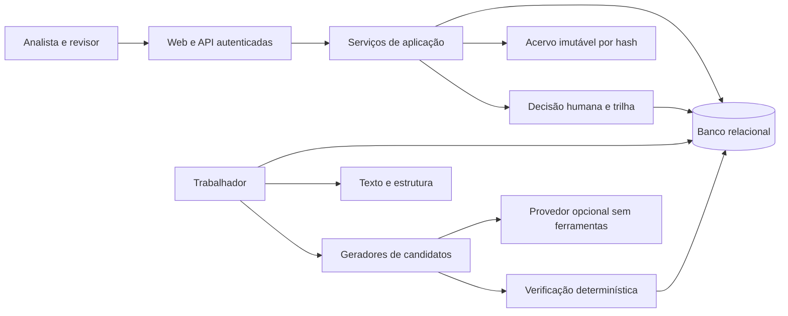

# Arquitetura implementável

Decisão de 04/11/2026: monólito modular Python 3.11+, FastAPI, Jinja2, SQLAlchemy, migrações versionadas, pdfplumber e PostgreSQL como banco de implantação. SQLite serve à operação local deste ambiente; não comprova semântica de concorrência do PostgreSQL.

FastAPI admite [upload](https://fastapi.tiangolo.com/tutorial/request-files/) e [templates](https://fastapi.tiangolo.com/advanced/templates/). pdfplumber fornece informação de caracteres e páginas, sem OCR, conforme sua [documentação](https://github.com/jsvine/pdfplumber/blob/stable/README.md), e usa [licença MIT](https://github.com/jsvine/pdfplumber/blob/stable/LICENSE.txt). Versões instaladas e licenças transitivas devem ser inventariadas.

## Limites de módulos

| Módulo | Contrato e responsabilidade |
| --- | --- |
| acervo | Inspecionar assinatura/tamanho, exigir origem, preservar bytes, deduplicar SHA-256, manter papel e proveniência. Nenhum acesso automático à URL declarada. |
| estrutura | Texto canônico versionado, páginas, intervalos Unicode, árvore normativa, autoria em alterações, links, datas evidenciadas e avisos de tabelas/OCR. |
| proposicao | Regras e adaptador de IA; respostas brutas, versão do prompt, descarte por item, escopo, cache e orçamento. |
| evidencias | Comparar trecho na unidade declarada, mapear normalização, sugerir alternativas sem mover âncora automaticamente. |
| temporal | Interpretar regras locais, resolver marco evidenciado, calcular e explicar; ausência/ambiguidade nunca vira data. |
| contestacao | Regras independentes por tipo; evidência literal, severidade e três estados; faixa de incerteza explicada. |
| decisao | Autenticação, papéis, justificativa, controle de versão esperada, correção append-only e travas. |
| trilha | Evento na mesma transação do comando, serialização canônica e encadeamento; verificador independente. |
| operacao | Fila durável, idempotência, leases, progresso, falhas e registros de chamadas; sem regras jurídicas. |
| apresentacao | Matriz, documento com realce, prazos, riscos, histórico, CSV/JSON/HTML. Não recalcula regras. |

## Modelo e invariantes

Arquivo, aquisição, documento lógico, extração canônica, página, unidade, relação, execução, resposta, interpretação, âncora, prazo, contestação, decisão e evento têm identidades separadas. Compartilhar texto não implica compartilhar contexto normativo.

Os intervalos usam [início, fim) em pontos de código Unicode do texto canônico, não bytes UTF-8 nem índices UTF-16 do navegador. O servidor produz o realce. A extração preserva versão do extrator, hash e páginas; reextração cria outro registro. Unidades e âncoras precisam satisfazer a igualdade entre seu texto e o recorte correspondente.

Um gerador só cria candidatos. Todo candidato exige ao menos uma evidência. Identificador fora do escopo enviado é rejeitado por item. Citação em unidade errada fica pendente, com alternativas. Coincidências ambíguas não são reassociadas. Somente espaços, aspas e travessões podem ser normalizados.

Prazos são dados separados das interpretações. Cada regra identifica seu próprio fundamento e trecho; herança só de caput explícito. Esclarecimento exige documento-alvo; evento futuro não recebe data emprestada. Dias úteis sem calendário versionado não são calculados. Meses e anos exigem convenção versionada para fim de mês. Toda data nasce provisória; confirmação é decisão separada.

Correção cria interpretação sucessora e reexecuta verificações. Revisão compara a versão esperada e rejeita comandos concorrentes obsoletos. Resolução de contestação registra decisão separada; não altera o achado original. Âncora inválida continua bloqueando mesmo se alguém tentar dispensar a contestação. Aceite técnico não estabelece validade jurídica.

## Persistência, fila e recuperação

Banco mantém integridade referencial e unicidades; tabelas auditáveis recusam UPDATE/DELETE pelo papel da aplicação. Projeções e jobs admitem atualização. O mecanismo de fila em PostgreSQL utilizará seleção com [SKIP LOCKED](https://www.postgresql.org/docs/18/sql-select.html) e restrições únicas. Esse recurso é apropriado para consumidores de fila; consultas de resultados não o utilizam.

Nesta primeira implementação, arquivos de até 10 MiB ficam em coluna binária imutável do banco, endereçados por hash. Bytes e proveniência participam da mesma transação. O armazenamento separado de objetos fica para evolução; nessa migração será necessário staging/reconciliação, pois não há transação atômica entre objeto e banco. Upload inválido não aparece como processado; documento corrompido é preservado com erro explícito de extração.

Chave de execução inclui extração, escopo ordenado, estratégia, gerador/prompt/schema e parâmetros. Intenção paga é durável antes da rede. Cache só é consumido depois de persistida a resposta. Após falha de resultado desconhecido não se repete pagamento automaticamente. Reprodução é rotulada e mantém a proveniência da resposta; resposta sintética nunca é apresentada como resposta de IA real.

Custos usam Decimal, moeda, preço com fonte/data e snapshot da tarifa. Estimativa de entrada é heurística sinalizada; teto de saída e limite conservador de entrada reservam orçamento antes da chamada. Sem preço verificável não há execução paga. Tokens e custo desconhecidos ficam nulos, nunca zero inventado. O adaptador segue o [contrato oficial de saída estruturada](https://developers.openai.com/api/docs/guides/structured-outputs); não há fallback de modelo.

## Segurança e evolução SaaS

Sessão opaca com expiração e cookie HttpOnly/SameSite; CSRF em mutações da interface; API autenticada por sessão. Identidade vem da sessão, não do formulário. Senhas armazenadas apenas como hash salgado; bootstrap por comando local. Papel jurídico não é inferido de um nome.

HTML recebido é convertido em texto, nunca servido como HTML ativo; realce escapa conteúdo. Upload tem limite, timeout de extração e limite de páginas. Segredos vêm do ambiente, não de documentos nem logs. Documentos são dados não confiáveis e o modelo não recebe ferramentas. Instalação local usa loopback; publicação requer HTTPS e configuração explícita.

API versionada, domínio desacoplado do transporte, storage por interface e espaços de trabalho explícitos permitem evolução. Antes de multiempresa: autorização por objeto, RLS/testes de isolamento, OIDC/SSO, retenção, backup/restauração e observabilidade operacional. Não se declara SaaS multi-inquilino pronto a partir desse desenho.
